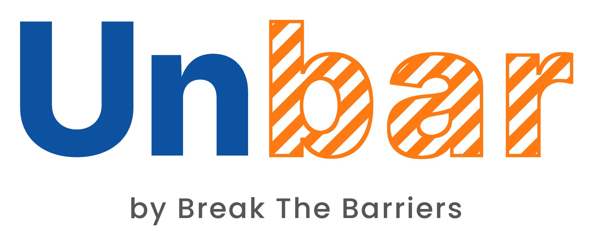
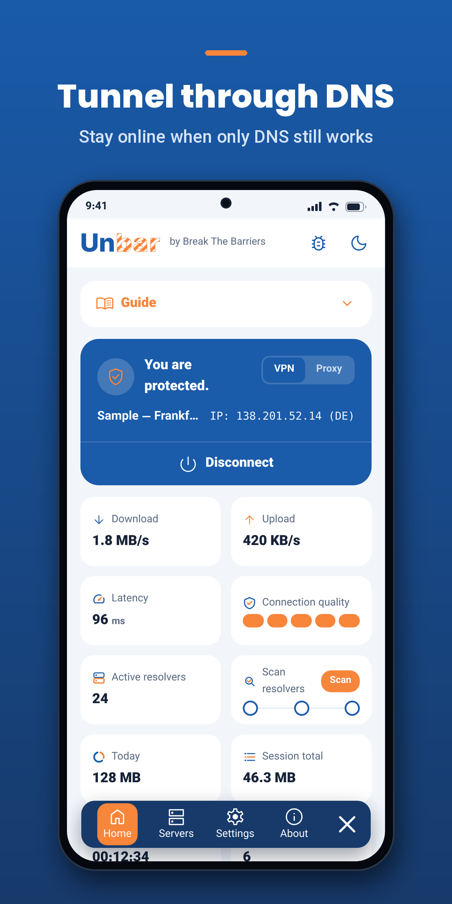
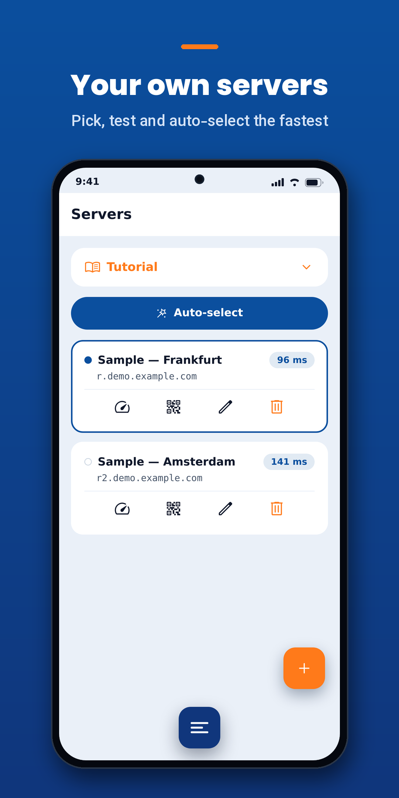
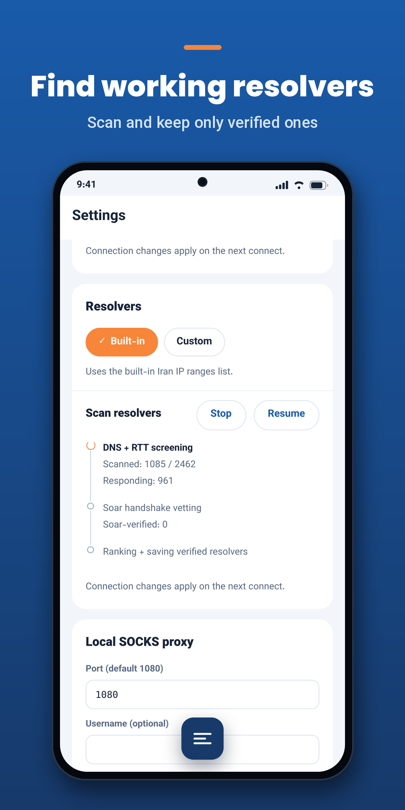
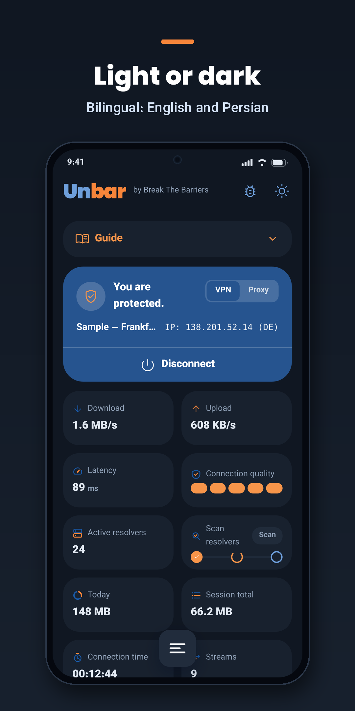

<p align="center">
  <picture>
    <source media="(prefers-color-scheme: dark)" srcset="assets/unbar-logo-dark.png">
    
  </picture>
  
</p>

<div dir="rtl" lang="fa">

# آنبار (Unbar)

**[فارسی](#فارسی) | [English](#english)**

---

<a id="فارسی"></a>

**آنبار™** یک کلاینت VPN تونل DNS برای اندروید و iOS است، بر پایهٔ [**Soar**](https://github.com/getlantern/soar)، از **Break The Barriers**.

> ساخته‌شده برای قطعی‌های کامل اینترنت،
> زمانی که DNS تنها راه خروج است.

آنبار ترافیک اینترنت شما را داخل کوئری‌های DNS جاسازی می‌کند و از طریق سرور خودتان عبور می‌دهد؛ بنابراین وقتی دسترسی مستقیم به اینترنت قطع شده اما DNS هنوز جواب می‌دهد، اتصال برقرار می‌ماند. آنبار هیچ سرور پیش‌فرضی ندارد و بدون سرور شما کار نمی‌کند — سرور را خودتان اضافه می‌کنید.

- وب‌سایت: [unbar.cc](https://unbar.cc)
- کانال تلگرام: [@Unbarapp](https://t.me/Unbarapp)
- نسخهٔ فعلی: **1.0.2** (بیلد 3) — اندروید و iOS

## اسکرین‌شات‌ها

<p align="center">
  
  
  
  
</p>

## آنبار چیست

آنبار یک VPN معمولی نیست. به‌جای اتصال مستقیم به یک سرور VPN، تونل Soar ترافیک را به‌صورت کوئری‌های DNS به یک zone (دامنهٔ) اختصاصی روی سرور شما می‌فرستد و داده‌ها در پاسخ‌های DNS برمی‌گردند. در گوشی، ترافیک از طریق پل hev-socks5-tunnel وارد تونل می‌شود. به همین دلیل آنبار در شرایطی کار می‌کند که VPNهای معمولی کاملاً از کار می‌افتند: قطعی کامل اینترنت، وقتی فقط DNS باز است.

برای استفاده از آنبار به یک سرور نیاز دارید. سرور را می‌توانید خودتان راه بیندازید یا از کسی که سرور دارد، کانفیگ بگیرید.

همان‌طور که در صفحهٔ «درباره»ٔ برنامه آمده: «A DNS-tunnel VPN client based on Soar, by Break The Barriers.» نسخهٔ پروتکل تونل Soar هم در همان صفحه نمایش داده می‌شود: v0.2.5.

## ویژگی‌ها

- **حالت VPN:** همهٔ ترافیک گوشی از تونل عبور می‌کند.
- **حالت SOCKS (پروکسی):** فقط برنامه‌هایی که پروکسی را تنظیم کرده‌اند از تونل استفاده می‌کنند. پروکسی SOCKS محلی روی `127.0.0.1:1080` (قابل تغییر) اجرا می‌شود و رمز اختیاری دارد.
- **اسکن ریزالورها:** ریزالورهای DNS را در سه مرحله بررسی می‌کند — غربال DNS و RTT، هندشیک Soar روی جواب‌دهنده‌ها، و رتبه‌بندی و ذخیرهٔ موارد تأییدشده در یک استخر. فقط ریزالورهایی که هندشیک Soar را با موفقیت پشت سر بگذارند «سالم» محسوب می‌شوند؛ ریزالورهای ازکارافتاده به‌صورت خودکار جایگزین می‌شوند.
- **لیست داخلی ریزالورهای ایرانی:** در حالت داخلی، از لیست داخلی ریزالورهای ایران استفاده می‌شود؛ در حالت سفارشی فقط ریزالورهایی که خودتان وارد کرده‌اید به کار می‌روند. بازه‌های CIDR هم پشتیبانی می‌شوند.
- **وارد کردن لیست ریزالور (Import):** یک فایل ‎.txt‎ با آی‌پی تکی و رنج (CIDR یا خط‌تیره‌دار) انتخاب کنید. برنامه لیست را خودکار تمیز می‌کند (عدد فارسی، فاصله و متن اضافه، ‎:53‎، تکراری‌ها، رنج‌های تودرتو)، مرتب می‌کند و گزارش اصلاحات را نشان می‌دهد. این لیست جدا از لیست سفارشی ذخیره می‌شود و دقیقاً مثل آن اسکن می‌شود. حداکثر ۱ مگابایت.
- **ایمپورت و اشتراک‌گذاری کانفیگ:** لینک `unbar://`، فایل JSON، یا اسکن کد QR. خروجی کانفیگ هم به‌صورت لینک یا QR صادر می‌شود؛ رمز پروکسی SOCKS محلی هرگز در خروجی قرار نمی‌گیرد.
- **اشتراک (Subscription):** با وارد کردن یک لینک HTTPS، لیست سرورها به‌صورت خودکار از آن لینک به‌روز می‌شود. سرورهایی که دستی اضافه کرده‌اید دست نمی‌خورند. فقط لینک‌های HTTPS پذیرفته می‌شوند.
- **تست تأخیر و انتخاب خودکار:** تأخیر هر سرور از داخل تونل اندازه‌گیری می‌شود و انتخاب خودکار سریع‌ترین سرور را برای اتصال برمی‌گزیند.
- **عبور مستقیم ایران:** دامنه‌های `.ir` و IPهای ایران مستقیم وصل می‌شوند و از تونل رد نمی‌شوند تا سایت‌های داخلی سریع‌تر باز شوند. اگر اتصال مستقیم در ۵ ثانیه جواب ندهد، به تونل برمی‌گردد. لیست عبور سفارشی و مسیریابی به‌ازای هر برنامه هم پشتیبانی می‌شود.
- **حالت TCP:** کوئری‌های DNS را به‌جای UDP/53 از TCP/53 می‌فرستد؛ فقط وقتی استفاده کنید که UDP مسدود است، چون کندتر است. در حالت خاموش هم TCP همان‌جا که UDP جواب ندهد به کار می‌رود.
- **محدودیت پهنای باند:** سقف جداگانه برای آپلود و دانلود (کیلوبایت/ثانیه؛ صفر یعنی نامحدود).
- **MTU خودکار و اندازهٔ جواب DNS:** هر دو به‌صورت خودکار بهترین مقدار را انتخاب می‌کنند؛ در صورت مشکل، مقدار دستی هم قابل تنظیم است.
- **آمار زنده:** سرعت واقعی روی سیم، تأخیر از داخل تونل، امتیاز کیفیت اتصال (۰ تا ۱۰۰)، تعداد ریزالورهای فعال، مصرف امروز و این ماه، زمان اتصال، مجموع نشست و تعداد استریم‌ها. کارت وضعیت IP و کشور سرور را هم نشان می‌دهد.
- **سابقهٔ اتصال**؛ در اندروید: کاشی تنظیمات سریع و ویجت صفحهٔ اصلی.
- **فارسی و انگلیسی، تم روشن و تیرهٔ «ابری».**
- **بررسی به‌روزرسانی:** از صفحهٔ تنظیمات می‌توانید بررسی کنید نسخهٔ جدیدی منتشر شده یا نه. در iOS صفحهٔ ریلیز در سافاری باز می‌شود؛ نصب از داخل برنامه ممکن نیست.
- همهٔ تنظیمات به‌صورت خودکار ذخیره می‌شوند؛ دکمهٔ ذخیرهٔ جداگانه‌ای وجود ندارد.

## تفاوت‌های iOS

نسخهٔ iOS همان هستهٔ مشترک Go و تونل Soar را دارد و بیشتر ویژگی‌ها یکسان‌اند؛ چند تفاوت:

- **تعویض حالت فقط در تنظیمات است:** در iOS حالت VPN یا SOCKS فقط از صفحهٔ تنظیمات عوض می‌شود؛ کارت وضعیت بج حالت ندارد.
- **مسیریابی به‌ازای هر برنامه ندارد:** VPN به‌ازای هر برنامه در iOS فقط با مدیریت سازمانی ممکن است.
- **حالت SOCKS ثانویه است:** در iOS محدودیت‌های پس‌زمینه کار با پروکسی محلی را محدود می‌کند؛ حالت اصلی VPN است.
- **آموزش:** آکاردئون‌های آموزشی هم در صفحهٔ اصلی و هم در تنظیمات هست.

## نصب

**اندروید**

1. از صفحهٔ [Releases](https://github.com/viahamed/unbar/releases) آخرین فایل APK را دانلود کنید. فایل مناسب گوشی‌تان را بگیرید: `arm64-v8a` برای بیشتر گوشی‌های جدید، `armeabi-v7a` برای گوشی‌های قدیمی‌تر ۳۲ بیتی، `x86_64` برای دستگاه‌های اینتلی، یا `universal` که روی همه کار می‌کند ولی بزرگ‌تر است.
2. آن را روی گوشی نصب کنید. آنبار به اندروید ۵٫۰ یا جدیدتر نیاز دارد.
3. یک سرور اضافه کنید (بخش بعد) و وصل شوید.

نسخه‌های منتشرشده با کلید ریلیز پروژه امضا می‌شوند.

**iOS**

نسخهٔ iOS فعلاً فقط با ساخت از سورس با Xcode نصب می‌شود (بخش «ساخت از سورس»)؛ در App Store یا TestFlight نیست. به iOS 14.0 یا جدیدتر نیاز دارد.

## اضافه کردن سرور

سه راه برای اضافه کردن سرور وجود دارد:

**۱. دستی** — در صفحهٔ سرورها روی `+` بزنید و وارد کنید:

- **نام سرور:** یک نام دلخواه
- **Zone:** دامنهٔ اختصاصی سرور، مثلاً `t.example.com`
- **کلید عمومی سرور:** کلید عمومی Ed25519 سرور به‌صورت Base64

**۲. ایمپورت کانفیگ** — لینک `unbar://` یا JSON کانفیگ را بچسبانید، یا کد QR کانفیگ را اسکن کنید.

**۳. اشتراک** — لینک اشتراک (HTTPS) را وارد کنید؛ لیست سرورها از آن لینک خوانده و به‌روز می‌شود.

فرمت کانفیگ (JSON):

```json
{
  "v": 1,
  "name": "My Server",
  "zone": "t.example.com",
  "pubkey": "AAAAAAAAAAAAAAAAAAAAAAAAAAAAAAAAAAAAAAAAAAA=",
  "resolverMode": "DISCOVERY",
  "resolvers": [],
  "country": "IR"
}
```

- `pubkey` کلید عمومی Ed25519 سرور است (Base64، بدون کلید خصوصی).
- `resolverMode` یا `DISCOVERY` است (استفاده از لیست داخلی و اسکن) یا `CUSTOM` (فقط ریزالورهای فهرست `resolvers`).
- `country` کد کشوری است که در کارت وضعیت نمایش داده می‌شود؛ در صورت خالی بودن، از روی IP سرور حدس زده می‌شود.

## راه‌اندازی سرور خودتان

برای راه‌اندازی سرور به این‌ها نیاز دارید:

- یک سرور (VPS) با IP عمومی
- یک دامنه که یک زیردامنهٔ آن را به سرور واگذار کنید (رکوردهای NS زیردامنه به IP سرور اشاره کنند) — این زیردامنه همان zone است
- پورت 53 (UDP و TCP) باز و در دسترس از اینترنت
- یک جفت‌کلید Ed25519؛ کلید خصوصی روی سرور می‌ماند و فقط کلید عمومی در کانفیگ آنبار وارد می‌شود

اسکریپت رسمی راه‌اندازی سرور، با آموزش گام‌به‌گام، در ریپوی [unbar-server](https://github.com/viahamed/unbar-server) است:

```bash
curl -fsSL https://raw.githubusercontent.com/viahamed/unbar-server/main/install.sh | sudo bash
```

بعد از نصب، با دستور `unbar` منو باز می‌شود و Setup wizard شما را قدم‌به‌قدم راهنمایی می‌کند. آموزش کامل: [آموزش گام‌به‌گام](https://github.com/viahamed/unbar-server#tutorial-fa).

## تنظیمات

- **اتصال:** حالت VPN یا SOCKS، حالت TCP، ‏MTU‏، اندازهٔ جواب DNS؛ در iOS حالت فقط از تنظیمات عوض می‌شود
- **ریزالورها:** حالت داخلی، سفارشی یا وارد کردن (فایل ‎.txt‎)، لیست ریزالورهای سفارشی، اسکن ریزالورها، ریزالورهای سالم ذخیره‌شده
- **پروکسی SOCKS محلی:** پورت، نام کاربری و رمز (اختیاری)
- **محدودیت پهنای باند:** سقف آپلود و دانلود
- **مسیریابی:** عبور مستقیم ایران، لیست عبور سفارشی، مسیریابی به‌ازای هر برنامه
- **ظاهر و زبان:** فارسی / انگلیسی / سیستم؛ روشن / تیره / سیستم
- **سیستم و عیب‌یابی:** سرعت در اعلان، دسترسی اعلان‌ها، معافیت از بهینه‌سازی باتری، لاگ‌های عیب‌یابی (اختیاری)، مشاهدهٔ لاگ‌ها، سابقهٔ اتصال؛ در iOS به‌جای آن VPN درخواستی و انتخاب خودکار سریع‌ترین سرور هست
- **به‌روزرسانی:** بررسی نسخهٔ جدید از صفحهٔ تنظیمات (در iOS صفحهٔ ریلیز در سافاری باز می‌شود)

تغییرات اتصال با اتصال بعدی اعمال می‌شوند.

## حریم خصوصی

- **بدون حساب کاربری:** آنبار نه ثبت‌نام دارد، نه ورود، نه شناسهٔ کاربری.
- **بدون سرور پیش‌فرض:** آنبار بدون هیچ سروری عرضه می‌شود؛ فقط به سروری وصل می‌شوید که خودتان اضافه کرده‌اید.
- **بدون ردیابی:** هیچ SDK تحلیل، تبلیغات یا گزارش خطا در برنامه نیست و هیچ داده‌ای به سازندهٔ برنامه فرستاده نمی‌شود.
- **لاگ‌های عیب‌یابی** به‌صورت پیش‌فرض خاموش‌اند و فقط روی گوشی شما ذخیره می‌شوند.
- **دسترسی‌ها:** اینترنت و وضعیت شبکه (برای تونل)، دوربین (فقط برای اسکن کد QR کانفیگ)، سرویس پیش‌زمینه (برای فعال ماندن تونل)، اعلان‌ها (برای نمایش وضعیت اتصال)، معافیت از بهینه‌سازی باتری (اختیاری، برای پایداری اتصال)، مشاهدهٔ برنامه‌های نصب‌شده (فقط برای مسیریابی به‌ازای هر برنامه).
- برچسب کشور سرور و اندازه‌گیری تأخیر، فقط وقتی وصل هستید و از داخل تونل انجام می‌شوند.
- لینک اشتراک فقط به همان آدرسی که خودتان وارد کرده‌اید درخواست می‌فرستد.

ترافیک شما فقط از سروری عبور می‌کند که خودتان انتخاب کرده‌اید؛ پس سرور را از منبعی بگیرید که به آن اعتماد دارید.

## ساخت از سورس

### اندروید

نیازمندی‌ها:

- JDK 17 و Android SDK (API 35)
- Go 1.26 یا جدیدتر
- Android NDK 27.2.12479018
- gomobile

هستهٔ مشترک Go از ماژول Soar استفاده می‌کند که در `third_party/soar` وندور شده است؛ پل hev-socks5-tunnel هم در `android/app/src/main/cpp/hev-socks5-tunnel-src` قرار دارد.

مراحل:

```sh
git clone https://github.com/viahamed/unbar.git
cd unbar

# ساخت هستهٔ مشترک (Go) به‌صورت .aar
cd core
go install golang.org/x/mobile/cmd/gomobile@latest
gomobile init
gomobile bind -androidapi 21 -target android/arm64,android/arm,android/amd64 \
  -o ../android/app/libs/unbar-core.aar .

# ساخت APK
cd ../android
./gradlew assembleDebug
```

فایل APK در `android/app/build/outputs/apk/debug/app-universal-debug.apk` ساخته می‌شود.

حداقل نسخهٔ اندروید ۵٫۰ (API 21) و نسخهٔ هدف API 35 است. نسخه‌های ریلیز در CI با کلید ریلیز پروژه امضا می‌شوند؛ کلید امضا در ریپو نیست.

### iOS

نیازمندی‌ها: macOS با Xcode نصب‌شده، Go 1.26 یا جدیدتر، gomobile. هستهٔ مشترک همان `core` است و با gomobile به‌صورت `.xcframework` ساخته می‌شود:

```sh
# از ریشهٔ ریپو، روی macOS با Xcode نصب‌شده:
gomobile bind -target ios -o ios/UnbarCore.xcframework ./core
cd ios
xcodebuild -project Unbar.xcodeproj -scheme Unbar \
  -sdk iphonesimulator -destination 'generic/platform=iOS Simulator' \
  CODE_SIGNING_ALLOWED=NO build
```

پروژهٔ Xcode با `tools/generate_project.py` ساخته می‌شود؛ بعد از اضافه یا حذف فایل، آن اسکریپت را دوباره اجرا کنید. حداقل نسخهٔ iOS 14.0 است.

## مشارکت

گزارش باگ و پول‌ریکوئست پذیرفته می‌شود. برای تغییرات بزرگ، لطفاً اول یک Issue باز کنید.

## لایسنس

آنبار نرم‌افزار آزاد است و تحت لایسنس GNU General Public License نسخه ۳
(GPL-3.0) منتشر می‌شود؛ می‌توانید طبق شرایط این لایسنس از آن استفاده کنید، آن را
تغییر دهید و منتشر کنید. نام‌ها و لوگوی «آنبار» و «Break The Barriers» علامت تجاری‌اند.
متن کامل در LICENSE. اجزای وندور شده (Soar و hev-socks5-tunnel) لایسنس خودشان
را دارند — THIRD_PARTY.md.

## اطلاعیه‌های third-party

این ریپو دو کامپوننت vendored دارد: تونل Soar (`third_party/soar`) و پل hev-socks5-tunnel (`android/app/src/main/cpp/hev-socks5-tunnel-src`). مجوزهای هر دو در فایل [THIRD_PARTY.md](THIRD_PARTY.md) آمده است.

## حمایت مالی

آنبار رایگان است. اگر برایتان مفید بود، با یک حمایت کوچک به ادامهٔ آن کمک کنید:

- **USDT (BEP20):** `0x46f872b46BFa471607ad0F0042bdFFCB2B9c702b`
- **TON:** `UQBdKaKX61k56IaJMbjTTMvXd7fskpbJnzGUPlQAyZT6RJn5`

صفحهٔ دونیت: [btb.onl/posts/post-2160.html](https://btb.onl/posts/post-2160.html)

</div>

---

<a id="english"></a>

# Unbar

**Unbar™** is a DNS-tunnel VPN client for Android and iOS, based on [**Soar**](https://github.com/getlantern/soar), by **Break The Barriers**.

> Built for total blackouts,
> when DNS is the only way out.

Unbar carries your internet traffic inside DNS queries, through a server of your own — so the connection stays up when direct internet access is cut but DNS still answers. Unbar ships with no built-in server and does nothing without one; you add your own server.

- Website: [unbar.cc](https://unbar.cc)
- Telegram channel: [@Unbarapp](https://t.me/Unbarapp)
- Current version: **1.0.2** (build 3) — Android and iOS

## Screenshots

<p align="center">
  
  
  
  
</p>

## What Unbar is

Unbar is not an ordinary VPN. Instead of connecting directly to a VPN server, the Soar tunnel sends traffic as DNS queries to a dedicated zone on your server, and data comes back inside DNS answers. On the phone, traffic enters the tunnel through the hev-socks5-tunnel bridge. That is why Unbar works where ordinary VPNs fail completely: total internet blackouts, when only DNS is still reachable.

Using Unbar requires a server. You can run your own, or get a config from someone who runs one.

As the About screen puts it: "A DNS-tunnel VPN client based on Soar, by Break The Barriers." The Soar tunnel protocol version (v0.2.5) is shown on the same screen.

## Features

- **VPN mode:** all of the phone's traffic goes through the tunnel.
- **SOCKS (proxy) mode:** only apps configured to use the proxy use the tunnel. A local SOCKS proxy runs on `127.0.0.1:1080` (changeable) with optional credentials.
- **Resolver scan:** checks DNS resolvers in three stages — DNS and RTT screening, a Soar handshake with every responder, then ranking and saving the verified ones into one pool. Only resolvers that pass the Soar handshake count as healthy; dead ones are replaced automatically.
- **Built-in Iranian resolver list:** in Built-in mode the built-in list of Iranian resolvers is used; in Custom mode only the resolvers you entered are used. CIDR ranges are supported.
- **Resolver import:** pick a .txt file of single IPs and ranges (CIDR or dash ranges). The app cleans it automatically (Persian digits, stray spaces and text, `:53`, duplicates, nested ranges), sorts it and shows a report of what it fixed. The imported list is stored separately from your Custom list and scanned exactly like it. Max 1 MB.
- **Config import and sharing:** `unbar://` links, pasted JSON, or QR code scanning. Configs can also be exported as a link or QR code; local SOCKS proxy credentials are never included in exports.
- **Subscriptions:** enter an HTTPS subscription link and the server list updates from it automatically. Manually added servers are left untouched. Only HTTPS links are accepted.
- **Latency test and auto-select:** each server's latency is measured through the tunnel, and auto-select picks the fastest server for the connection.
- **Iran geo bypass:** `.ir` domains and Iranian IPs connect directly, bypassing the tunnel so domestic sites open faster. If the direct connection fails within 5 seconds, it falls back to the tunnel. A custom bypass list and per-app routing are also supported.
- **TCP mode:** sends DNS queries over TCP/53 instead of UDP/53; use it only when UDP is blocked, as it is slower. When off, TCP is still used wherever UDP fails.
- **Bandwidth limit:** separate upload and download caps (KB/s; 0 means unlimited).
- **Auto MTU and DNS answer size:** both pick the best value automatically; manual values are available if you run into trouble.
- **Live stats:** true wire speed, latency measured through the tunnel, a connection quality score (0–100), active resolver count, today and this-month usage, connection time, session total, and stream count. The status card also shows the server's IP and country.
- **Connection history**; on Android: a Quick Settings tile and a home-screen widget.
- **English and Persian, light and dark "Cloud" themes.**
- **Check for update:** check for a newer release from the Settings page. On iOS the release page opens in Safari; installing from inside the app is not possible.
- Every setting saves automatically; there is no separate Save button.

## iOS differences

The iOS version uses the same shared Go core and Soar tunnel, and most features are the same; a few differences:

- **Mode switching lives in Settings only:** on iOS the VPN or SOCKS mode is switched from the Settings page; the status card has no mode badge.
- **No per-app routing:** per-app VPN on iOS is only possible with enterprise management.
- **SOCKS mode is secondary:** on iOS, backgrounding limits what other apps can do with a local proxy; VPN is the primary mode.
- **Guide / Tutorials:** the Home page has a Guide accordion; Settings and Servers have Tutorial accordions.

## Installation

**Android**

1. Download the latest APK from the [Releases](https://github.com/viahamed/unbar/releases) page. Pick the APK for your device: `arm64-v8a` for most modern phones, `armeabi-v7a` for older 32-bit phones, `x86_64` for Intel-based devices, or `universal`, which works everywhere but is larger.
2. Install it on your phone. Unbar requires Android 5.0 or newer.
3. Add a server (next section) and connect.

Published releases are signed with the project's release key.

**iOS**

The iOS version is currently installed by building from source with Xcode only (see "Building from source"); it is not on the App Store or TestFlight. It requires iOS 14.0 or newer.

## Adding a server

There are three ways to add a server:

**1. Manually** — on the Servers page, tap `+` and enter:

- **Server name:** any name you like
- **Zone:** the server's dedicated domain, e.g. `t.example.com`
- **Server public key:** the server's Ed25519 public key, in Base64

**2. Import a config** — paste an `unbar://` link or config JSON, or scan a config QR code.

**3. Subscription** — enter an HTTPS subscription link; the server list is read and updated from that link.

Config format (JSON):

```json
{
  "v": 1,
  "name": "My Server",
  "zone": "t.example.com",
  "pubkey": "AAAAAAAAAAAAAAAAAAAAAAAAAAAAAAAAAAAAAAAAAAA=",
  "resolverMode": "DISCOVERY",
  "resolvers": [],
  "country": "IR"
}
```

- `pubkey` is the server's Ed25519 public key (Base64; no private key).
- `resolverMode` is either `DISCOVERY` (built-in list and scanning) or `CUSTOM` (only the resolvers in `resolvers`).
- `country` is the country code shown on the status card; when empty, it is guessed from the server's IP.

## Running your own server

To run a server you need:

- A server (VPS) with a public IP
- A domain with a subdomain delegated to the server (the subdomain's NS records point at the server) — that subdomain is the zone
- Port 53 (UDP and TCP) open and reachable from the internet
- An Ed25519 key pair; the private key stays on the server, and only the public key goes into Unbar's config

The official server setup script, with a step-by-step tutorial, lives in the [unbar-server](https://github.com/viahamed/unbar-server) repo:

```bash
curl -fsSL https://raw.githubusercontent.com/viahamed/unbar-server/main/install.sh | sudo bash
```

After install, `unbar` opens the menu and the Setup wizard walks you through it. Full tutorial: [Step-by-step tutorial](https://github.com/viahamed/unbar-server#tutorial).

## Settings

- **Connection:** VPN or SOCKS mode, TCP mode, MTU, DNS answer size; on iOS the mode is switched from Settings only
- **Resolvers:** Built-in, Custom or Import (.txt file) mode, custom resolver list, resolver scan, remembered healthy resolvers
- **Local SOCKS proxy:** port, username and password (optional)
- **Bandwidth limit:** upload and download caps
- **Routing:** Iran geo bypass, custom bypass list, per-app routing
- **Appearance & language:** English / Persian / System; Light / Dark / System
- **System & diagnostics:** speeds in notification, notification permission, battery optimization exemption, diagnostic logs (optional), view logs, connection history; on iOS, on-demand VPN and auto-select fastest instead
- **Update:** check for a new version from the Settings page (on iOS the release page opens in Safari)

Connection changes apply on the next connect.

## Privacy

- **No account:** Unbar has no sign-up, no login, no user ID.
- **No built-in server:** Unbar ships with no server; you only connect to a server you added yourself.
- **No tracking:** the app contains no analytics, advertising, or crash-reporting SDKs, and sends no data to the app's author.
- **Diagnostic logs** are off by default and stored only on your phone.
- **Permissions:** internet and network state (for the tunnel), camera (only to scan config QR codes), foreground service (to keep the tunnel alive), notifications (to show connection status), battery optimization exemption (optional, for connection stability), viewing installed apps (only for per-app routing).
- The server country tag and latency measurement only run while you are connected, and through the tunnel.
- A subscription link is only fetched from the address you entered yourself.

Your traffic only passes through a server you chose; get a server from a source you trust.

## Building from source

### Android

Requirements:

- JDK 17 and the Android SDK (API 35)
- Go 1.26 or newer
- Android NDK 27.2.12479018
- gomobile

The shared Go core uses the Soar module, vendored under `third_party/soar`; the hev-socks5-tunnel bridge lives in `android/app/src/main/cpp/hev-socks5-tunnel-src`.

Steps:

```sh
git clone https://github.com/viahamed/unbar.git
cd unbar

# Build the shared (Go) core as an .aar
cd core
go install golang.org/x/mobile/cmd/gomobile@latest
gomobile init
gomobile bind -androidapi 21 -target android/arm64,android/arm,android/amd64 \
  -o ../android/app/libs/unbar-core.aar .

# Build the APK
cd ../android
./gradlew assembleDebug
```

The APK is built at `android/app/build/outputs/apk/debug/app-universal-debug.apk`.

Minimum Android version is 5.0 (API 21); target is API 35. Release builds are signed in CI with the project's release key; the signing key is not in the repo.

### iOS

Requirements: macOS with Xcode installed, Go 1.26 or newer, gomobile. The shared core is the same `core`, built with gomobile as an `.xcframework`:

```sh
# From the repo root, on macOS with Xcode installed:
gomobile bind -target ios -o ios/UnbarCore.xcframework ./core
cd ios
xcodebuild -project Unbar.xcodeproj -scheme Unbar \
  -sdk iphonesimulator -destination 'generic/platform=iOS Simulator' \
  CODE_SIGNING_ALLOWED=NO build
```

The Xcode project is generated with `tools/generate_project.py`; re-run that script after adding or removing files. Minimum iOS version is 14.0.

## Contributing

Bug reports and pull requests are welcome. For larger changes, please open an issue first.

## License

Unbar is free software, licensed under the GNU General Public License v3.0
(GPL-3.0). You may use, study, share, and modify it under the terms of that
license. "Unbar" and "Break The Barriers" names and logos are trademarks of
Break The Barriers. Full text in LICENSE. Vendored components (Soar and
hev-socks5-tunnel) keep their own licenses — see THIRD_PARTY.md.

## Third-party notices

This repo vendors two components: the Soar tunnel (`third_party/soar`) and the hev-socks5-tunnel bridge (`android/app/src/main/cpp/hev-socks5-tunnel-src`). Their licenses are listed in [THIRD_PARTY.md](THIRD_PARTY.md).

## Donate

Unbar is free. If it helped you, a small donation keeps it going:

- **USDT (BEP20):** `0x46f872b46BFa471607ad0F0042bdFFCB2B9c702b`
- **TON:** `UQBdKaKX61k56IaJMbjTTMvXd7fskpbJnzGUPlQAyZT6RJn5`

Donate page: [btb.onl/posts/post-2160.html](https://btb.onl/posts/post-2160.html)
